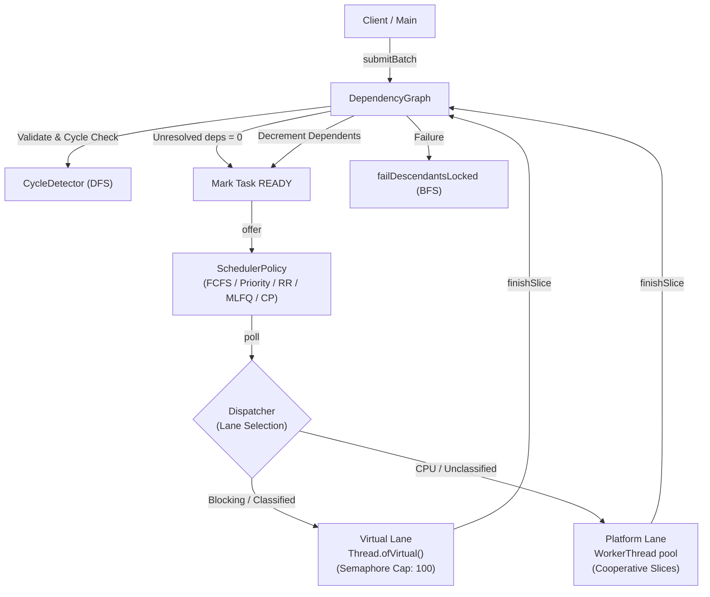

# AGENTS.md — Agent & Developer Context Guide

> [!IMPORTANT]
> This guide provides system context, architectural invariants, code patterns, and testing conventions for AI coding agents and human contributors working on this codebase.

---

## 1. Project Overview & Context

- **Project Name:** Dependency-Aware Thread Pool (`edu.oslab.threadpool`)
- **Root Directory:** `/home/rewansh/Programming/Dependency-Aware-Thread-Pool`
- **Maven Submodule:** `dependency-aware-thread-pool/`
- **Language / Runtime:** Java 25 (configured with `--release 25`)
- **Build System:** Apache Maven 3.9+
- **Test Framework:** JUnit 5 (`org.junit.jupiter`)
- **Logging:** SLF4J 2.0.17 + Logback 1.5.18 (thread-tagged format `%thread`)

---

## 2. Architectural Invariants (Non-Negotiable Rules)

1. **Strictly No Pre-Built Thread Pools:**
   - **NEVER** use `java.util.concurrent.ExecutorService`, `Executors`, `ThreadPoolExecutor`, `ForkJoinPool`, or `CompletableFuture` for task dispatch or execution in the pool.
   - The thread pool must manage platform threads manually using `WorkerThread extends Thread`.
   - Virtual threads must be launched directly via `Thread.ofVirtual().name(...).start(...)`.
2. **Strictly No External Graph Libraries:**
   - **NEVER** add or import graph libraries (e.g. JGraphT, Guava).
   - Adjacency lists, Kahn's topological sort, reverse topological critical-path traversal, and white/gray/black cycle detection are implemented by hand.
3. **Single JVM, In-Memory Only:**
   - No distributed coordination, sockets, serialization, disk persistence, or IPC.
4. **Locking Discipline:**
   - Synchronization in `ThreadPoolManager` is managed through an explicit `ReentrantLock` and associated `Condition` instances (`workAvailable`, `stateChanged`).
   - Every `Condition.await()` or `Condition.awaitNanos()` call **must** be enclosed in a `while` loop (guarding against spurious wakeups).
   - Locks and semaphore permits must always be released in `finally` blocks.
5. **Decoupled Layers:**
   - The **Dependency Manager sits above the Scheduler**.
   - Schedulers never inspect dependency graphs; they only receive tasks that are already `READY`.

---

## 3. System Architecture & Lifecycle



### Task Lifecycle State Machine
```text
  PENDING ───► READY ───► RUNNING ───► DONE
     │           │           │
     ▼           ▼           ▼
   FAILED      FAILED      FAILED
                             │
                             └───► READY (if yielded)
```
- **States:** Defined in `TaskState` (`PENDING`, `READY`, `RUNNING`, `DONE`, `FAILED`).
- `DONE` and `FAILED` are terminal.
- Cascading Failure: When a task fails, all transitive downstream dependents are failed immediately via `DependencyGraph.descendantsOf()`.

---

## 4. Execution Lanes & Cooperative Slicing

### Platform Lane (`Lane.PLATFORM`)
- Managed by `WorkerThread` instances waiting on `workAvailable` condition.
- Tasks execute cooperative slices via `CooperativeWork.runSlice(quantumMillis)`.
- If a task returns `SliceResult.yielded()`, `ThreadPoolManager.finishSlice()` transitions the task back to `READY` and calls `scheduler.requeueAfterYield()`.
- If a task returns `SliceResult.done()`, it transitions to `DONE` and unblocks dependents.

### Virtual Lane (`Lane.VIRTUAL`)
- For tasks where `task.spec().blocking() == true` or classified as blocking.
- Starts a dedicated virtual thread via `Thread.ofVirtual().name("virtual-task-" + id).start(...)`.
- Bounded by a `Semaphore` (default 100) to cap maximum concurrently executing task bodies.
- Virtual tasks run through their slices to completion (`Long.MAX_VALUE` budget).
- `Dispatcher.virtualTasksPending()` increments at dispatch and decrements upon completion, ensuring `awaitTermination()` waits for all in-flight virtual work.

### Automatic Lane Classification (`LaneClassifier`)
- Opt-in profiling (`enabled = false` by default).
- Measures CPU time vs wall-clock time on the platform lane using `ThreadMXBean.getCurrentThreadCpuTime()`.
- Note: `ThreadMXBean` CPU timing is **unsupported on virtual threads** (returns -1); observation must only occur during platform runs.
- Tasks with mean CPU/wall ratio < 20% over 5 samples are classified as `VIRTUAL` for future runs.

---

## 5. Scheduling Policies

All schedulers implement `edu.oslab.threadpool.scheduler.SchedulerPolicy`:
- **`FcfsScheduler`**: Queue-order dispatch; yielded tasks re-insert at the head.
- **`PriorityScheduler`**: Priority with linear aging (`waitedNanos / agingIntervalNanos`). FIFO sequence tie-breaker.
- **`RoundRobinScheduler`**: Queue-order dispatch; yielded tasks re-insert at the tail.
- **`MlfqScheduler`**: 3 priority tiers with quanta [10ms, 25ms, 50ms]. Yield demotes one level; periodic `boostAll` resets all tasks to level 0.
- **`CriticalPathScheduler`**: Priority queue ordered by `task.criticalPathWeight()` descending. Dynamic priority recalculation on subsequent batch submissions via `refreshPriorities()`.

---

## 6. Directory Map

```text
dependency-aware-thread-pool/
├── pom.xml
└── src/
    ├── main/java/edu/oslab/threadpool/
    │   ├── benchmark/
    │   │   ├── BenchmarkHarness.java        # Multi-policy benchmark execution
    │   │   ├── BenchmarkResult.java         # Immutable benchmark run record
    │   │   ├── MetricsReporter.java         # Formats ASCII & per-lane tables
    │   │   ├── MixedWorkloadBenchmark.java  # 3 shapes x 3 configs hybrid test
    │   │   ├── RandomDagFactory.java        # Reproducible random acyclic DAGs
    │   │   ├── ScalingReport.java           # Summary with CSV writer
    │   │   ├── ScalingStudy.java            # Multi-point task scaling study
    │   │   └── WorkloadFactory.java         # Functional interface for workloads
    │   ├── classifier/
    │   │   └── LaneClassifier.java          # ThreadMXBean CPU/wall classifier
    │   ├── experiment/
    │   │   └── PinningExperiment.java       # Carrier thread blocking benchmark
    │   ├── scheduler/
    │   │   ├── SchedulerPolicy.java         # Pluggable scheduler interface
    │   │   ├── FcfsScheduler.java           # FCFS implementation
    │   │   ├── PriorityScheduler.java       # Priority with aging
    │   │   ├── RoundRobinScheduler.java     # Round robin implementation
    │   │   ├── MlfqScheduler.java           # 3-level MLFQ implementation
    │   │   └── CriticalPathScheduler.java   # Critical path scheduler
    │   ├── CooperativeWork.java             # Task work lambda
    │   ├── CycleDetector.java               # DFS cycle detection
    │   ├── DeadlockDetectedException.java   # Exception with cycle path
    │   ├── DependencyGraph.java             # Adjacency lists & ready logic
    │   ├── Dispatcher.java                  # Virtual thread dispatcher
    │   ├── Lane.java                        # PLATFORM vs VIRTUAL enum
    │   ├── Main.java                        # CLI entry point
    │   ├── SliceResult.java                 # yielded vs done record
    │   ├── Task.java                        # Runtime task entity
    │   ├── TaskMetrics.java                 # Task timing statistics
    │   ├── TaskSpec.java                    # Immutable task specification
    │   ├── TaskState.java                   # State machine enum
    │   ├── ThreadPoolManager.java           # Core pool manager
    │   └── WorkerThread.java                # Manual platform worker thread
    └── test/java/edu/oslab/threadpool/
        ├── BenchmarkFeaturesTest.java       # Scaling & metrics tests
        ├── SchedulerPolicyTest.java         # Policy unit tests
        └── ThreadPoolManagerTest.java       # Concurrency, DAG & hybrid tests
```

---

## 7. Developer & Agent Workflow

### Build and Verify
Always run Maven commands from `dependency-aware-thread-pool`:

```bash
cd dependency-aware-thread-pool

# Run test suite (must be 23/23 green)
mvn clean test

# Run default CLI demo
mvn exec:java

# Run scaling benchmark
mvn exec:java -Dexec.args="--scale 2"

# Run hybrid benchmark
mvn exec:java -Dexec.args="--hybrid 1"

# Run carrier pinning experiment
mvn exec:java -Dexec.args="--pinning"
```

### Common Pitfalls to Avoid
1. **Never alter task state outside `synchronized` methods on `Task`:** Transitions (`transitionTo`, `markDispatched`) require thread safety and strict state-machine validation.
2. **Never hold `lock` while executing task work:** In `WorkerThread` and `Dispatcher`, task work (`runSlice()`) must always run without holding the `ThreadPoolManager` monitor lock.
3. **Always pair `virtualTasksPending.incrementAndGet()` with decrement in `finally`:** The pool's shutdown barrier (`awaitTermination`) relies on `virtualTasksPending == 0`.
4. **Use `System.nanoTime()` for durations, not `System.currentTimeMillis()`:** Wall-clock time can skew with NTP updates; all benchmarks and metric calculations use monotonic nanos.

