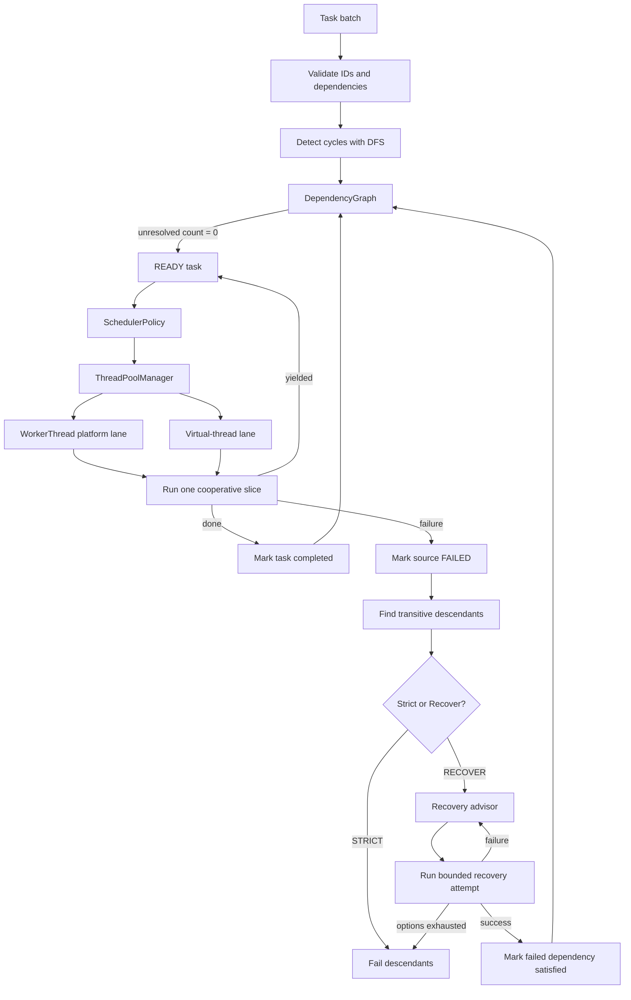

# Dependency-Aware Thread Pool

This project implements an in-memory Java thread pool for tasks that depend on other tasks. It is designed to demonstrate two closely related problems:

1. How to release tasks in the correct order when work is represented as a dependency graph.
2. How to recover from a failed task without leaving its downstream tasks permanently blocked.

The core engine is independent of Spring and can be run from the command line or tested directly. An optional web module visualizes the same engine, but the dependency graph and recovery logic are implemented in `threadpool-core`.

## The problem

Consider this workflow:

```text
fetch source ──> compile ──> test ──> package
                         └──> static analysis
```

`compile` cannot run until `fetch source` completes. `test` and `static analysis` cannot run until `compile` completes. A simple FIFO queue does not contain enough information to enforce these rules.

Putting dependency checks inside worker code is also undesirable. A worker that waits for another task is occupied but does no useful work. Cycles are another problem: if `A` waits for `B` and `B` waits for `A`, the workflow can never make progress.

This project keeps dependency management separate from scheduling:

- `DependencyGraph` decides when a task becomes ready.
- `SchedulerPolicy` decides which ready task should run next.
- `ThreadPoolManager` coordinates task state, workers, failure handling, and recovery.

## Core architecture



The graph controls eligibility; the scheduler never inspects dependency edges. This allows the same graph to be tested with FCFS, priority, Round Robin, MLFQ, or critical-path scheduling.

## Dependency graph implementation

`DependencyGraph` uses hand-written adjacency lists:

- `dependencies`: each task and the tasks it depends on;
- `dependents`: each task and the tasks that depend on it;
- `unresolvedCounts`: the number of prerequisites that have not yet been satisfied;
- `completed` and `satisfiedDependencies`: graph bookkeeping for completed and recovered prerequisites.

### Batch validation

`registerBatch` validates the complete batch before changing the registered graph. It checks:

1. task IDs are unique within the batch;
2. task IDs do not already exist in the pool;
3. every dependency refers to the same batch or to an already registered task; and
4. the combined graph contains no cycle.

If any check fails, the batch is rejected without partially registering its tasks.

### Cycle detection

`CycleDetector` uses depth-first search with three colors:

- **white**: not visited;
- **gray**: currently being explored; and
- **black**: fully explored.

An edge to a gray node is a back edge and proves that a cycle exists. The detector returns the cycle path, which is wrapped in `DeadlockDetectedException` for callers.

### Releasing ready tasks

Tasks with zero unresolved prerequisites are returned as initially ready. When a task completes, `markCompleted` visits its direct dependents and decrements their unresolved counts. A dependent becomes ready exactly when its count reaches zero.

This is a Kahn-style topological release process. Workers do not wait inside task code for prerequisites; pending tasks simply remain outside the scheduler queue.

The graph also supports:

- breadth-first descendant traversal for failure propagation;
- topological ordering for graph analysis; and
- reverse topological critical-path weight calculation for the critical-path scheduler.

## Task lifecycle

```text
PENDING --> READY --> RUNNING --> DONE
   |         |          |
   |         |          +--> FAILED
   |         +-------------> FAILED
   +-----------------------> FAILED

RUNNING -- yielded --> READY
```

- `PENDING`: waiting for prerequisites.
- `READY`: eligible and present in a scheduler queue.
- `RUNNING`: currently executing.
- `DONE`: completed successfully.
- `FAILED`: failed, cancelled, or invalidated by a failed dependency.

Task state changes are synchronized by `Task` and coordinated by `ThreadPoolManager` under an explicit `ReentrantLock`. Task work is never executed while the manager lock is held.

## Recovery model

The pool supports two modes:

- `STRICT`: a task failure immediately fails all transitive descendants.
- `RECOVER`: the pool first attempts configured recovery options; descendants are failed only when recovery is unavailable or exhausted.

### Recovery flow

When a task fails in `RECOVER` mode:

1. The source task is marked `FAILED`.
2. Its descendants are marked `RECOVERING` and removed from normal scheduling.
3. A `RecoverySession` is created for the failed source.
4. A `RecoveryOptionProvider` supplies bounded options for that task.
5. A `RecoveryAdvisor` selects one option.
6. The pool validates that the option exists and has not already been attempted.
7. The selected option is scheduled as an internal recovery task.
8. The result determines whether dependents are released or another option is tried.

The advisor runs outside the manager lock. The selected recovery attempt is then scheduled through the same pool machinery as ordinary work, so it is included in normal synchronization and shutdown behavior.

### Recovery options

A recovery option contains an ID, type, cost, quality score, attempt limit, and an executable `TaskSpec`. Recovery execution tasks cannot have dependencies; they are bounded operations that either succeed or fail.

The built-in rule-based advisor scores unused options using:

- option quality;
- recovery cost;
- failed-task priority; and
- estimated downstream work.

The web module can provide a catalog or an optional external advisor, but the core always validates advisor decisions and falls back to the deterministic rule-based advisor when necessary.

### Successful recovery

Recovery does not pretend that the original task succeeded. The original task remains `FAILED` in task metrics and history. Instead, a successful recovery calls `markRecovered` on the dependency graph:

```text
failed source --successful recovery--> dependency satisfied
                                      --> eligible dependents become READY
```

This distinction keeps the failure visible while allowing the workflow to continue safely.

### Failed and exhausted recovery

If a recovery attempt fails, the session records that option and asks the advisor for another unused option. When all options are exhausted, the session is removed and all transitive descendants are failed with a dependency-failure reason.

A failed task with no descendants does not open a recovery session because there is no downstream work to release. It remains a failed leaf, which is useful for demonstrating the difference between recoverable dependency failures and terminal leaf failures.

## Scheduling and execution support

Recovery and dependency release are independent of the scheduling policy. The core includes:

| Policy | Ready-task behavior |
|---|---|
| FCFS | Queue order; yielded tasks return to the front. |
| Priority | Priority with linear aging for waiting tasks. |
| Round Robin | Queue order; yielded tasks return to the back. |
| MLFQ | Three priority levels with demotion on yield and periodic boosting. |
| Critical Path | Highest estimated remaining dependency-path weight first. |

Platform work runs on manually managed `WorkerThread` instances. Blocking work can run on directly started virtual threads using `Thread.ofVirtual()`, with a semaphore limiting concurrent virtual task bodies. Platform work uses cooperative slices that return `yielded` or `done`; this is a safe scheduling boundary rather than forced preemption.

The project deliberately does not use `ExecutorService`, `Executors`, `ThreadPoolExecutor`, `ForkJoinPool`, or `CompletableFuture` to dispatch core pool work. It also does not use an external graph library.

## Core technology stack

| Area | Technology |
|---|---|
| Language/runtime | Java 25 |
| Build | Apache Maven 3.9+ and a multi-module reactor |
| Synchronization | `ReentrantLock`, `Condition`, `Semaphore`, and Java thread APIs |
| Graph algorithms | Hand-written adjacency lists, DFS cycle detection, topological release, BFS descendant traversal |
| Logging | SLF4J 2.0.17 and Logback 1.5.18 |
| Testing | JUnit Jupiter 5.12.2 |
| Optional visualization | Spring Boot 4.1.1, Spring MVC, SSE, React, TypeScript, and Vite |

The optional web layer exposes the core engine through REST and Server-Sent Events, but it does not replace the core graph or recovery implementation.

## Core project structure

```text
threadpool-core/src/main/java/edu/oslab/threadpool/
├── DependencyGraph.java          # Dependencies, readiness, descendants, path weights
├── CycleDetector.java            # DFS cycle detection
├── ThreadPoolManager.java        # Lifecycle, dispatch, failure, and recovery coordination
├── Task.java / TaskState.java    # Runtime task and lifecycle state
├── Recovery*.java                # Recovery modes, options, context, and advisors
├── WorkerThread.java             # Manual platform worker
├── Dispatcher.java               # Platform/virtual lane selection
└── scheduler/                    # Pluggable ready-queue policies

threadpool-core/src/test/java/edu/oslab/threadpool/
└── RecoveryTest.java             # Recovery releases a dependent after source failure
```

## Build and test

Requirements:

- JDK 25
- Apache Maven 3.9 or newer

Run the full reactor test suite from the repository root:

```bash
mvn test
```

Run the core demonstration:

```bash
cd threadpool-core
mvn exec:java
```

The most important core guarantee is:

> The dependency graph decides when work is eligible; the scheduler decides which eligible work runs; recovery decides whether a failed prerequisite can be safely satisfied.
