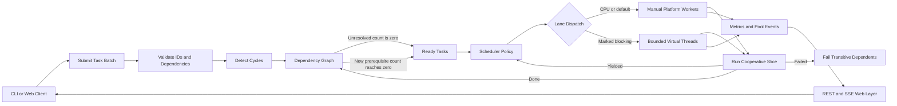

# Dependency-Aware Thread Pool

An operating-systems project that implements a dependency-aware task pool in Java and makes its behavior visible through a browser-based simulator. It combines explicit task-graph management, hand-managed platform workers, cooperative scheduling, virtual-thread execution for blocking work, several ready-queue policies, and an event-streaming Spring Boot interface.

The repository is organized as a Maven reactor with two Java modules. `threadpool-core` contains the pool and benchmark code without a Spring dependency. `threadpool-web` exposes the engine through REST and Server-Sent Events (SSE) and serves the frontend built from `threadpool-core/frontend/`.

## Problem statement

Many programs are pipelines or workflows rather than collections of independent jobs. A task may only run after one or more prerequisites have completed. Examples include compiling a module after its dependencies, processing an image after its source has been fetched, or running a report after several data jobs finish.

A conventional ready queue represents only *which task should run next*. It does not by itself represent *which tasks are allowed to run*. Placing every submitted task directly in the queue can violate prerequisites. Having workers wait inside task code for prerequisites wastes worker capacity and complicates deadlock handling. A failure can also leave downstream tasks waiting forever unless the system defines what happens to dependents.

This project addresses those coordination problems in one in-memory JVM:

1. Accept a batch of tasks and validate its IDs and dependency references.
2. Reject dependency cycles before registering any part of the batch.
3. Keep tasks with unresolved prerequisites out of the scheduler.
4. Move tasks into the ready queue only when their prerequisites have completed.
5. Select ready work using a pluggable scheduling policy and execute it on an appropriate lane.
6. Record completion, failure, cancellation, metrics, and events so the run can be inspected.

The central separation is that **the dependency manager decides whether a task is ready; the scheduler decides which ready task runs next**. A scheduling policy never has to inspect or reinterpret the graph.

## The idea and project contribution

The project does not claim to invent a new scheduling algorithm. FCFS, priority scheduling, Round Robin, multilevel feedback queues, and critical-path prioritization are established ideas. The project’s contribution is an integrated, inspectable implementation that puts these ideas together under explicit operating-systems constraints:

- **Graph-aware release with interchangeable scheduling.** Dependency resolution is performed before scheduling, so each policy sees the same valid ready tasks. This makes comparisons between policies easier to understand.
- **Manual platform-thread management.** The pool owns `WorkerThread` instances and coordinates them with a `ReentrantLock` and `Condition`; a prebuilt executor does not dispatch pool work.
- **Cooperative preemption points.** Since Java cannot safely stop arbitrary platform-thread code at a time quantum, work returns `yielded` or `done` at defined slice boundaries. Policies can reorder a yielded task at those boundaries.
- **A hybrid execution model.** CPU-oriented tasks use the platform-worker lane, while tasks marked as blocking can run on directly started virtual threads, subject to a concurrency limit.
- **Failure propagation through the graph.** If a task fails, transitive dependents are failed instead of being left permanently blocked behind an impossible prerequisite.
- **Observable execution.** The web interface streams real pool events, supports event replay for reconnecting clients, and exposes task and run metrics. A separate headless comparison path avoids measuring the browser and event-stream overhead as scheduler time.

Together these elements make the project useful as a teaching and experimentation tool: a learner can connect graph algorithms, lifecycle synchronization, thread behavior, and scheduling policy to visible run traces. The implementation is a focused educational project, not a production workflow engine or a claim that one policy is universally faster.

## Scope

### Included

- A single-JVM, in-memory task pool with explicit task IDs and dependency edges.
- Finite batches of tasks. Dependencies may refer to tasks in the same batch or tasks already registered in the pool; references to unknown or future tasks are rejected.
- Atomic batch validation for duplicate IDs, unknown dependencies, and cycles.
- Task states `PENDING`, `READY`, `RUNNING`, `DONE`, and `FAILED`.
- Five scheduler policies: FCFS, priority with aging, Round Robin, three-level MLFQ, and critical-path priority.
- Manually managed platform workers and cooperative task slices.
- Optional blocking-task execution on virtual threads, with a semaphore limiting concurrent virtual task bodies.
- Optional sampling-based lane classification for platform work. It is disabled by default.
- Failure injection, cancellation, descendant failure propagation, task timing metrics, benchmark workloads, and event reporting.
- A Spring Boot API and browser interface for creating, observing, cancelling, and comparing runs.
- A local runner that builds and starts the web application with its bundled frontend.

### Outside the scope

- Multi-process or distributed scheduling, cluster coordination, networking between workers, or inter-process communication.
- Persistent storage. Run state and traces are held in memory and are lost when the application stops.
- Authentication, authorization, tenant isolation, or a production security model.
- Arbitrary user-provided executable code. Web runs are built from controlled task specifications and simulated work; the API does not accept code to execute.
- Forced preemption of arbitrary Java code. A cooperative task must return from `runSlice` for the pool to observe a yield, cancellation, or injected failure boundary.
- A third-party graph library or a prebuilt executor for dispatching core pool tasks.
- A universal performance ranking. Benchmark results depend on the machine, workload, worker count, and system load.

## Architecture at a glance



The core dependency direction is one-way: the web module depends on the core module. The core has no Spring dependency and can be run from the command line or used independently.

## Task lifecycle and dependency behavior

Each submitted `TaskSpec` contains an ID, base priority, estimated burst duration, dependency IDs, a `CooperativeWork` implementation, and a blocking-work flag. The task specification is immutable; the runtime `Task` tracks state and measurements.

```text
PENDING ── prerequisites complete ──> READY ── dispatch ──> RUNNING ── done ──> DONE
   │                                     │                    │
   └─────────────────────────────────────┴────────────────────┴── failure/cancel ──> FAILED
                                                              │
                                                              └── yield ──> READY
```

`DependencyGraph` maintains both prerequisite and dependent adjacency lists. It validates the proposed graph before mutating the registered graph. `CycleDetector` uses depth-first white/gray/black marking and reports a cycle path. On successful completion, only direct dependents have their unresolved counts decremented; any task whose count reaches zero becomes ready. Workers do not occupy threads while waiting for prerequisites.

When a running task fails, its transitive descendants are failed immediately. A cancelled run fails waiting tasks right away and marks running tasks failed when their current cooperative slice returns. Cancellation cannot interrupt arbitrary Java code safely, so a task that does not return from its slice can delay completion of cancellation.

## Core modules and responsibilities

### Maven reactor

The root `pom.xml` defines the Java 25 compiler release and builds both modules together. Maven dependency direction is `threadpool-web` → `threadpool-core`; the core does not depend on Spring. The root build also makes the frontend available to the web module during packaging.

### `threadpool-core`: pool engine and experiments

This is the Spring-free implementation of the scheduling and dependency model.

| Package or class | Responsibility |
|---|---|
| `TaskSpec`, `Task`, `TaskState`, `TaskMetrics` | Immutable input, runtime task state machine, lifecycle timestamps, selected lane, and timing data. |
| `CooperativeWork`, `SliceResult`, `SimulatedWork` | Work contract and the result of a slice: yield for another turn or finish the task. |
| `DependencyGraph`, `CycleDetector`, `DeadlockDetectedException` | Graph registration and validation, unresolved prerequisite counts, cycle detection, newly-ready release, descendant traversal, and critical-path weights. |
| `ThreadPoolManager` | Pool lifecycle, submission, state transitions, worker synchronization, dispatch coordination, completion waits, failure propagation, cancellation, and listener notifications. |
| `WorkerThread` | A manually managed platform worker that waits for work and runs platform-lane slices without holding the pool lock during task execution. |
| `Dispatcher`, `Lane` | Routes work to the platform lane or starts a named virtual thread for blocking work; virtual task execution is bounded by a semaphore. |
| `PoolEventListener` | Core event callback surface. The engine does not depend on the web event implementation. |
| `scheduler/` | `SchedulerPolicy` and five ready-queue policy implementations. Each scheduler works with tasks already declared ready. |
| `classifier/LaneClassifier` | Optional sampling of platform CPU time versus wall-clock time to classify work types for later virtual-lane execution. Disabled by default. |
| `benchmark/` | Repeated policy comparisons, generated acyclic DAGs, mixed platform/virtual workloads, scaling summaries, CSV output, and formatted reports. |
| `experiment/PinningExperiment` | Experiment comparing virtual-thread carrier behavior while blocked in monitor and lock regions. |
| `Main` | CLI demonstrations and benchmark entry points. |

### Scheduler policies

The scheduler only orders the current ready set. Dependency release is handled separately.

| Policy | How it chooses and requeues work |
|---|---|
| **FCFS** | Chooses in queue order. A yielded task is reinserted at the head to continue before later arrivals. |
| **Priority with aging** | Chooses the highest effective priority. Waiting time adds a linear aging increment, with FIFO ordering as a tie-breaker. |
| **Round Robin** | Chooses in queue order and appends a yielded task to the tail. |
| **MLFQ** | Uses three priority levels with suggested quanta of 10, 25, and 50 ms. A task that yields is demoted; periodic boosts return tasks to the top level. |
| **Critical path** | Chooses the ready task with the greatest estimated remaining path weight, derived from its estimated burst and longest dependent path. FIFO order breaks ties. |

Quanta are cooperative budgets, not hard time limits. If task code runs past its budget without returning, the pool cannot take the worker away from that task.

### Execution lanes

- **Platform lane:** Tasks not classified as blocking run on `WorkerThread` instances. They execute one cooperative slice, then either finish or return to the scheduler according to the policy’s yield behavior.
- **Virtual lane:** Tasks explicitly marked blocking, or selected by the opt-in classifier, run on directly started virtual threads. Virtual tasks are limited by a semaphore and execute their slices through completion. A virtual-only workload still uses platform workers to dispatch the tasks.
- **Lane classifier:** Samples CPU and wall time for platform slices. After enough samples for a work type, a low mean CPU-to-wall ratio can classify later instances as virtual-lane work. CPU-time observation is performed on platform threads; automatic classification is off by default.

### Benchmarks and measurements

`BenchmarkHarness` obtains a fresh workload and scheduler for each policy run, waits for completion, and collects task metrics. The scaling tools use reproducible acyclic graphs and repeated runs. The benchmark result types and reporters summarize makespan, throughput, waiting time, turnaround time, and platform/virtual lane counts and averages; scaling reports can be written as CSV.

Metrics use monotonic elapsed-time measurements. In this project, waiting time is measured from submission to first dispatch, turnaround time from submission to completion, and throughput as completed tasks per elapsed second. These values describe the included synthetic workloads on the machine where they run; they are not general performance guarantees.

### `threadpool-web`: REST, run management, and event delivery

This Spring Boot module adapts core pool operations to HTTP and manages independent in-memory runs.

| Package | Responsibility |
|---|---|
| `controller/` | REST endpoints for presets, run creation/start/state/deletion, cancellation, task failure injection, traces, metrics, SSE events, and headless compare jobs. |
| `service/` | Run lifecycle and limits, pool construction, task-spec validation, built-in presets, run cleanup, and asynchronous policy comparison. |
| `dto/` | Request and response records; keeps the HTTP representation separate from core runtime objects. |
| `event/` | Pool event records, bounded subscriber queues, trace storage/replay, SSE writing, and client disconnect handling. |
| `config/`, `error/` | Web configuration, capacity settings, and mapping of validation/capacity/not-found failures to API responses. |
| `WebApplication` | Spring Boot application entry point. |

The live event endpoint uses SSE. Events have monotonically sequenced IDs and reconnecting clients can send `Last-Event-ID` to resume from the retained in-memory trace. The separate `/api/compare` path runs the same submitted workload under each policy without live event streaming, which is more appropriate for policy timing comparisons.

### `threadpool-core/frontend`: browser interface

The React, TypeScript, and Vite frontend has two modes:

- **Simulated:** A browser-side presentation model for exploring graph states and scheduling policies. Its displayed simulated times are not measurements from the Java pool.
- **Live Java:** Creates and starts a backend run, subscribes to SSE events, polls run state and metrics, and exposes cancellation and task-failure controls.

During Maven packaging, `frontend-maven-plugin` provisions Node.js/npm, installs the locked dependency set, builds the frontend, and places the static assets in the web module so Spring Boot serves them at `/`.

## API overview

The web API is rooted at `/api`:

| Method and path | Purpose |
|---|---|
| `GET /api/presets` | List built-in task-graph presets. |
| `POST /api/runs` | Validate and create a run from a task batch. |
| `POST /api/runs/{runId}/start` | Start dispatch for a created run. |
| `GET /api/runs/{runId}` | Read run state and task states. |
| `GET /api/runs/{runId}/events` | Subscribe to the live event stream; supports `Last-Event-ID` replay. |
| `GET /api/runs/{runId}/trace` | Retrieve the retained event trace. |
| `GET /api/runs/{runId}/metrics` | Read run and task metrics. |
| `POST /api/runs/{runId}/tasks/{taskId}/fail` | Inject a task failure for demonstration. |
| `POST /api/runs/{runId}/cancel` | Cancel the run. Running work reaches the cancellation boundary when its slice returns. |
| `DELETE /api/runs/{runId}` | Remove a finished run. |
| `POST /api/compare` | Submit a headless comparison job across scheduling policies. |
| `GET /api/compare/{jobId}` | Read comparison job status or result. |

### Recovery examples

Three recovery workloads live under [`examples/`](examples/). Each one injects failures that exercise
every RECOVER-mode outcome once: cache hit, successful retry, substitute, skip, retry-then-cache,
exhaustion cascade, and a leaf failure with no dependents.

| Example | Preset name | Shape |
|---------|-------------|-------|
| [`examples/recovery-build-mesh.json`](examples/recovery-build-mesh.json) | Recovery · Build Mesh | Compile diamond / fan-in |
| [`examples/recovery-service-graph.json`](examples/recovery-service-graph.json) | Recovery · Service Graph | Multi-service fan-out/join |
| [`examples/recovery-release-gate.json`](examples/recovery-release-gate.json) | Recovery · Release Gate | Staging→prod with blocking I/O |

The same workloads are available in the browser: start the app, click **Live Java**, and choose a
**Recovery · …** preset (Build Mesh is preselected).

```bash
curl -s -X POST http://localhost:8080/api/runs \
  -H 'Content-Type: application/json' \
  --data @examples/recovery-build-mesh.json

# Use the returned runId:
curl -X POST http://localhost:8080/api/runs/<runId>/start
curl http://localhost:8080/api/runs/<runId>/trace
```

Recovery here means dependency-aware task failure recovery. It does not restore files or restart
the application: when a task fails, the advisor selects one bounded catalog operation—retry a
simulated operation, use a cached result, use a substitute, or skip an optional task. The rule-based
advisor is offline; the live advisor is optional and falls back to the rule-based advisor.

Default web limits are five concurrent runs, 500 tasks per run, 2,000 in-flight tasks across runs, 16 workers per run, and five minutes of finished-run retention. These are configurable with `threadpool.limits.*`. Task burst estimates are capped at 60,000 ms by `TaskSpecFactory`. Run and compare state are in-memory and do not survive an application restart.

## Build and run

### Requirements

- JDK 25
- Apache Maven 3.9 or newer

The Maven compiler uses `--release 25`. The web build provisions its Node.js/npm toolchain through Maven.

### Run the web application locally

From the repository root:

```bash
./run-local.sh
```

Open [http://localhost:8080](http://localhost:8080) for the simulator and live Java modes.

Set `JAVA_OPTS` to pass JVM options, or pass application arguments after the script name:

```bash
JAVA_OPTS="-Xmx1g" ./run-local.sh
./run-local.sh --server.port=8081
```

### Local environment configuration

`run-local.sh` automatically loads `.env` when it exists. Use [`.env.example`](.env.example) as
the template for server, pool limits, SSE settings, LLM endpoint/timeout/call limit, logging, and
JVM options. The `.env` file is ignored by Git; set `GEMINI_API_KEY` there only when deliberately
using the Live AI advisor. An empty key keeps the rule-based fallback available.

### Run CLI demonstrations and benchmarks

From `threadpool-core/`:

```bash
mvn exec:java
mvn exec:java -Dexec.args="--scale 2"
mvn exec:java -Dexec.args="--hybrid 1"
mvn exec:java -Dexec.args="--pinning"
```

The default CLI demo exercises the five policies on a small dependency-aware workload and demonstrates cycle rejection. `--scale` runs generated DAGs at increasing task counts; `--hybrid` compares platform-only, virtual-only, and hybrid lane configurations over several workload shapes; `--pinning` runs the virtual-thread carrier blocking experiment. Synthetic benchmark timings vary by hardware and load.

### Tests

Run the Maven test suite from the repository root:

```bash
mvn test
```

## Project map

```text
.
├── pom.xml                         # Java 25 Maven reactor
├── run-local.sh                    # Build and run the web app on the host
├── threadpool-core/
│   ├── src/main/java/edu/oslab/threadpool/
│   │   ├── scheduler/               # Five ready-queue policies
│   │   ├── benchmark/               # Comparisons, scaling, reports
│   │   ├── classifier/              # Optional lane classification
│   │   ├── experiment/              # Carrier blocking experiment
│   │   ├── DependencyGraph.java     # Prerequisite tracking and release
│   │   ├── ThreadPoolManager.java   # Pool state and worker coordination
│   │   └── WorkerThread.java        # Manual platform worker
│   └── frontend/                    # React/TypeScript UI source
└── threadpool-web/
    └── src/main/java/edu/oslab/threadpool/web/
        ├── controller/              # REST and SSE endpoints
        ├── service/                  # Run lifecycle and compare jobs
        ├── event/                    # Trace, replay, and SSE subscribers
        └── dto/                      # HTTP request/response types
```

## Further reading

- [Core design, execution lanes, and benchmark details](threadpool-core/README.md)
- [Frontend design notes](threadpool-core/DESIGN.md)
